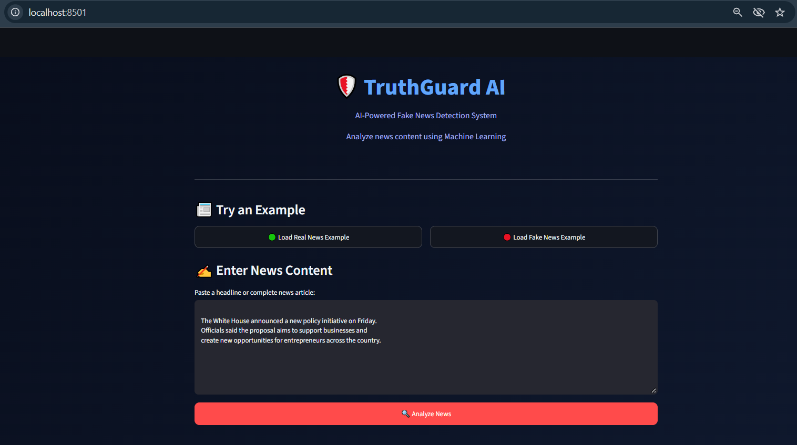
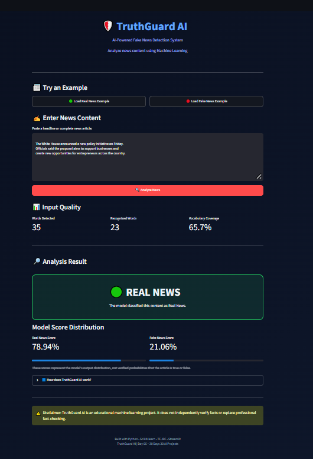
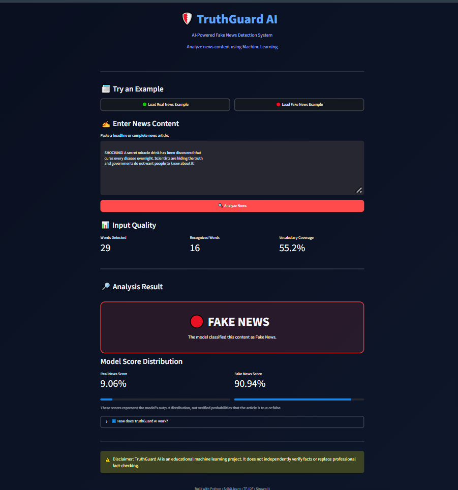
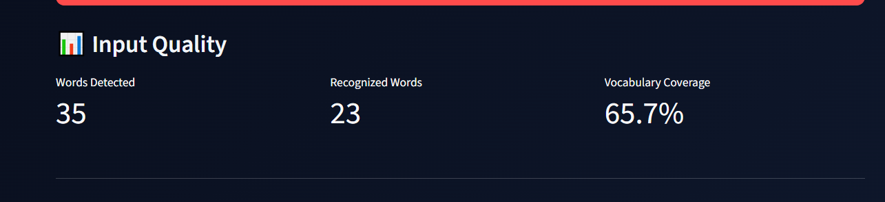

# 🛡️ TruthGuard AI – Fake News Detection System

An AI-powered Fake News Detection application built using **Python, Scikit-learn, TF-IDF, Logistic Regression, and Streamlit**.

TruthGuard AI analyzes submitted news content and classifies it as Real News or Fake News using Natural Language Processing (NLP) and Machine Learning.

> ⚠️ This is an educational ML classifier, not an independent fact-checking system. Predictions may be incorrect.

## 🚀 Features

- 📰 News headline and article analysis
- 🤖 Machine Learning-based classification
- 🔍 Text preprocessing and cleaning
- 📊 TF-IDF feature extraction
- 🧠 Logistic Regression classifier
- 📈 Real vs Fake model score distribution
- 📝 Input quality and vocabulary coverage analysis
- 🌐 Interactive Streamlit web interface

## 🛠️ Tech Stack

| Technology | Purpose |
|---|---|
| Python | Core programming |
| Pandas | Data processing |
| Scikit-learn | Machine Learning |
| TF-IDF | Text feature extraction |
| Logistic Regression | Classification |
| Streamlit | Web interface |
| Joblib | Model serialization |

## 📂 Project Structure

```text
Fake-News-Detection/
│
├── dataset/
│   └── processed_news.csv
│
├── models/
│   ├── fake_news_model.pkl
│   └── tfidf_vectorizer.pkl
│
├── screenshots/
│   ├── dashboard.png
│   ├── real-news.png
│   ├── fake-news.png
│   └── input-quality.png
│
├── app.py
├── predict.py
├── train_model.py
├── preprocess.py
├── explore_dataset.py
├── text_cleaner.py
├── requirements.txt
└── README.md
```

## 📸 Application Screenshots

### 🏠 Dashboard



### 🟢 Real News Detection



### 🔴 Fake News Detection



### 📊 Input Quality Analysis



## 📊 Model Performance

The model was trained using the Kaggle Fake and Real News dataset.

| Metric | Result |
|---|---:|
| Total processed articles | 38,826 |
| TF-IDF features | 20,000 |
| Cross-validation folds | 3 |
| Cross-validation Macro F1 | 98.89% |
| Test Accuracy | 98.97% |
| Test Macro F1 | 98.96% |

### Confusion Matrix

| Actual / Predicted | Real | Fake |
|---|---:|---:|
| Real | 4,166 | 20 |
| Fake | 60 | 3,520 |

**Note:** These results are from a held-out split of the same dataset. They do not guarantee equivalent performance on independent or real-world news. Dataset patterns and source-specific language may influence the results.

## ⚙️ Installation and Setup

### 1. Clone the repository

```bash
git clone https://github.com/YOUR_USERNAME/Fake-News-Detection.git
cd Fake-News-Detection
```

### 2. Create a virtual environment

```bash
python -m venv venv
```

### 3. Activate the environment

Windows PowerShell:

```powershell
.\venv\Scripts\Activate.ps1
```

### 4. Install dependencies

```bash
pip install -r requirements.txt
```

### 5. Run the application

```bash
python -m streamlit run app.py
```

The application will open in your browser.

## 🧠 How It Works

1. **Data Collection:** Load real and fake news articles from the dataset.
2. **Preprocessing:** Clean text, remove URLs and unnecessary characters, and remove duplicates.
3. **Feature Extraction:** Convert text into numerical features using TF-IDF with unigrams and bigrams.
4. **Model Training:** Train a Logistic Regression classifier.
5. **Prediction:** Transform user-submitted content and predict its category.
6. **Visualization:** Display the prediction, model score distribution, and input quality metrics.

## 📚 Dataset

Dataset: [Fake and Real News Dataset – Kaggle](https://www.kaggle.com/datasets/clmentbisaillon/fake-and-real-news-dataset)

The original dataset contains separate real and fake news CSV files.

Raw dataset files are not included in this repository.

## 🔮 Future Improvements

- Test with independent, more recent news datasets.
- Improve detection of unfamiliar news sources and topics.
- Add explainable AI to highlight influential words.
- Integrate trusted fact-checking sources.
- Deploy the application publicly.

## 👨‍💻 Author

**Vignesh U**

Aspiring AI/ML Engineer | Full Stack Developer

GitHub: [@21vicky](https://github.com/21vicky)

---

⭐ If you find this project interesting, consider giving the repository a star!

**Built as part of the 30 Days – 30 AI Projects Challenge.**